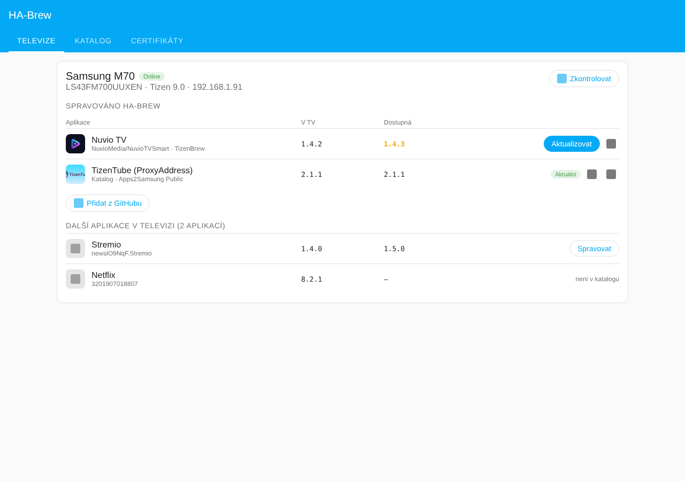

# HA-Brew

Keep homebrew apps on your smart TVs up to date from Home Assistant.

HA-Brew downloads new releases of TV apps from GitHub or a community catalog and installs them over the network: on **Samsung Tizen** TVs re-signed with **your own Samsung certificate**, on **LG webOS** TVs through Developer Mode. You get one native `update` entity per app, so updates show up in *Settings → Updates*, on dashboards, and in automations (for example, "install when the TV is on but nothing is playing").

On LG TVs HA-Brew also keeps the **Developer Mode session** alive, so your homebrew apps are not wiped after 1000 hours.

> **Status: early preview (0.4.x).** Samsung Tizen and LG webOS (without root).



**→ [Step-by-step installation guide](docs/installation.md)** · [Návod v češtině](docs/installation.cs.md)

## How it works

### Samsung (Tizen)

1. Your TV is in **Developer Mode**, and its *Host PC IP* points to your Home Assistant.
2. You upload the certificate the app was originally installed with: a TizenBrew Installer config, or an Apps2Samsung / Tizen Studio `.p12` pair.
3. HA-Brew checks GitHub for new releases. When an update is installed, it:
   - re-signs the `.wgt` package with your certificate,
   - pushes it to the TV over `sdb` (TCP 26101),
   - installs it in place, so app data and logins are kept.

### LG (webOS)

1. The TV runs the **Developer Mode** app (Dev Mode on). Root is not needed.
2. When you add the TV, HA-Brew downloads the Developer Mode SSH key once from the TV's *Key Server* and decrypts it with the passphrase shown on screen.
3. Packages (`.ipk`) are streamed to the TV over SSH (port 9922) and installed with the TV's own app installer, the same way Homebrew Channel does it. No signing, no certificates.
4. Once a day HA-Brew restarts the Developer Mode session at LG, and it shows the remaining hours as a sensor. This works while the TV is off.

No Tizen Studio, no webOS CLI, no PC and no extra add-on are needed. Everything runs inside Home Assistant (LG support installs the pure-Python `asyncssh` library).

## Requirements

- Home Assistant 2025.8 or newer.
- A Samsung Tizen TV or monitor with Developer Mode enabled:
  1. Open *Apps*.
  2. Type `12345` with the remote (or the SmartThings app's virtual remote).
  3. Switch Developer Mode on and set **Host PC IP** to your Home Assistant's IP.
  4. Restart the TV: hold the power button until the logo appears.
- The signing certificate the app was installed with (see [Certificates](#certificates)).

> Setting the Host PC IP to Home Assistant means other tools on your PC (Apps2Samsung, TizenBrew Installer) cannot reach the TV until you switch it back.

- Or an LG webOS TV with the **Developer Mode** app (LG Content Store) signed in with a free [LG developer account](https://webostv.developer.lge.com/) and **Dev Mode Status** on. Homebrew Channel and apps installed by it keep working; HA-Brew can take them over.

## Installation (HACS)

1. In HACS, open the menu and choose *Custom repositories*. Add this repository's URL with type **Integration**.
2. Install **HA-Brew** and restart Home Assistant.
3. Go to *Settings → Devices & services → Add integration → HA-Brew*, choose Samsung or LG and enter the TV's IP address.
   - LG: on the TV open the Developer Mode app, switch **Key Server** on and type the passphrase it shows. You can switch Key Server off again afterwards.

## The HA-Brew panel

HA-Brew adds a **HA-Brew** entry to the sidebar (admins only):

- **TVs**: every app on each TV with the installed and the available version. Install, update, reinstall, launch (▶), stop managing or uninstall apps from the TV. Apps that were installed some other way can be taken over with **Manage**, if the catalog has them.
- **Catalog**: Samsung: about 200 community Tizen web apps from the [Apps2Samsung catalog](https://github.com/Apps2Samsung/tizen-community-packages), with search, categories, Tizen version requirements and warnings (root, closed source, self-updating, Partner certificate). LG: the [webOS Homebrew repository](https://repo.webosbrew.org) (apps marked *needs root* do not work without root). Add any of them to a TV and install it right away. Downloads are checked against the catalog's SHA-256.
- **Certificates** (Samsung only): the signing certificates of each TV, their expiry and which apps use them.

LG TVs also show the Developer Mode session (hours left) with an **Extend** button.

You can still add apps from any GitHub repository, either in the panel (**Add from GitHub**) or on the integration page.

## Setup

### Samsung

After adding the TV, use the buttons on the integration page:

1. **Add certificate**, choosing one of the two formats:
   - *TizenBrew Installer*: upload `tizenbrewInstallerConfig.json`. It lives in `%USERPROFILE%\share\` on the computer where TizenBrew Installer ran.
   - *author.p12 + distributor.p12*: Apps2Samsung keeps them in `%APPDATA%\Apps2Samsung\Certificate\<profile>\`, with the password in `password.txt`.
2. **Add app**: pick a preset (Nuvio TV) or any GitHub repository plus a regular expression for the release file, for example `\.wgt$`. Then select the certificate.

An `update.<tv>_<app>` entity appears. Press **Install** to update.

### LG

No certificates. **Add app** on the integration page offers Nuvio TV and YouTube AdFree, any GitHub repository (`\.ipk$`), and the panel adds apps from the webOS Homebrew catalog. Apps already installed through Homebrew Channel can be taken over from the panel: updates install over them and keep their data.

Entities of an LG TV:

- `update.<tv>_<app>` per app,
- `sensor.<tv>_developer_mode_remaining` (hours left in the Developer Mode session),
- `button.<tv>_extend_developer_mode`.

If the session cannot be extended or less than 7 days are left, a repair issue appears. If Developer Mode was switched off and on again, the TV gets a new key; Home Assistant then shows a re-authentication request on the integration page and asks for the new passphrase.

### Waking up the TV

A TV in standby does not answer. Under **Configure** on the integration page you can choose how HA-Brew wakes it up before installing or launching an app:

- **Wake-on-LAN**: the TV's MAC address (TV menu: *Settings → Support → About This TV*, or your router). On Samsung TVs enable *Settings → General → Network → Expert Settings → Power On with Mobile*.
- **Turn on an entity**: for example the `media_player` of the [SamsungTV Smart](https://github.com/ollo69/ha-samsungtv-smart), the built-in Samsung Smart TV or the LG webOS TV integration. HA-Brew calls `turn_on` on it (`press` for a button, `turn_on` for a script).

HA-Brew then waits until the TV answers (60 s by default) and sends the wake-up once more halfway through.

## Certificates (Samsung)

A Tizen app can only be updated with the **same author certificate** it was installed with.

- **Create one with HA-Brew** (*Add certificate → Create a new certificate*): sign in with a free Samsung account; Home Assistant creates the keys, has Samsung issue an author and a distributor certificate for all your Samsung TVs and stores them. Samsung only sends the sign-in result to `localhost:4794` on the computer with the browser, so the dialog gives you a one-line command (PowerShell or `curl | python3`) that opens the sign-in and passes the result to Home Assistant. Nothing is installed.
- **Upload an existing one**: `tizenbrewInstallerConfig.json` from TizenBrew Installer, or `author.p12` + `distributor.p12` from Apps2Samsung / Tizen Studio.

Certificates are stored in Home Assistant's private `.storage` folder, never in `/config/www`. Samsung's public CA certificates are bundled (`drivers/tizen/ca/`). See the [installation guide](docs/installation.md#23-add-the-signing-certificate) for details.

## Reporting problems

*Settings → Devices & services → HA-Brew → ⋮ → Download diagnostics* (with the TV on) creates a file with the TV model, system version, apps and the last errors; addresses, keys, serial numbers and certificate details are removed. Attach it to a [GitHub issue](https://github.com/Michailjovic/HA-Brew/issues).

## Example automation

Install updates automatically when the TV is on but idle:

```yaml
alias: HA-Brew – auto update TV apps
triggers:
  - trigger: state
    entity_id: update.samsung_tv_nuvio_tv
    to: "on"
  - trigger: state
    entity_id: media_player.samsung_tv
    to: "idle"
conditions:
  - condition: state
    entity_id: update.samsung_tv_nuvio_tv
    state: "on"
  - condition: state
    entity_id: media_player.samsung_tv
    state: ["on", "idle"]
actions:
  - action: update.install
    target:
      entity_id: update.samsung_tv_nuvio_tv
mode: single
```

## Roadmap

- [x] Samsung Tizen: sdb transport, package signing, update entities
- [x] App catalog (Apps2Samsung community packages) and a sidebar panel to browse and install apps
- [ ] Native `.tpk` packages
- [x] Creating Samsung certificates from Home Assistant (Samsung account sign-in)
- [x] LG webOS (Developer Mode: SSH install, automatic Developer Mode renewal, webOS Homebrew catalog)
- [ ] Certificate renewal helper

## Credits

The signing logic follows Samsung's webIDE-common-tizentv (Apache-2.0), as used by
[TizenBrew Installer](https://github.com/reisxd/TizenBrewInstaller) and
[NuvioTVSmart-Installer](https://github.com/NuvioMedia/NuvioTVSmart-Installer).
The app catalog format comes from [Apps2Samsung](https://github.com/Apps2Samsung/tizen-community-packages).
LG support builds on the work of the [webOS Homebrew Project](https://www.webosbrew.org) (Developer Mode, repository API) and
[Webos-renew-dev](https://github.com/SR-Lut3t1um/Webos-renew-dev) (session renewal).

## License

GPL-3.0-only. See [LICENSE](LICENSE).
